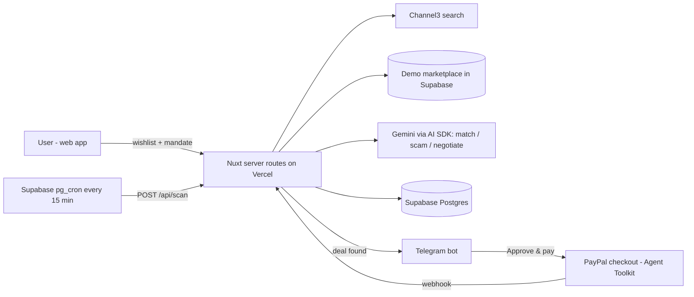

# DealHound 🐕 — your AI buyer's agent

> Tell it what you want and your max price. It watches the internet, screens out scams, haggles with sellers, and pings you on Telegram with a deal you approve and pay for with PayPal.

Built for the **PayPal AI Hackathon 2026** (Devpost). Working name — rename freely.

---

## The problem

- Good deals are scattered across thousands of retailers and secondhand listings; checking them manually is a chore.
- Haggling is awkward and most people leave money on the table.
- Online purchase scams are common, and the people most likely to fall for a "too good to be true" listing are the ones hunting hardest for a bargain.

## What DealHound does

1. **Wishlist** – "Noise-cancelling headphones, model X, black, new or like-new, max S$380."
2. **Watch** – a scheduled agent scans **Channel3** (100M+ products from 25k+ retailers) and a secondhand marketplace every 15 minutes.
3. **Match** – an LLM checks each result really matches the spec (not a cheaper look-alike model).
4. **Scam-check** – statistical price anomaly vs. retail comps + rule signals (off-platform payment, urgency, new account, duplicated text) + an LLM explanation that **quotes the evidence**.
5. **Negotiate** – for negotiable listings, a buyer agent haggles with the seller's agent. A **code-enforced mandate** means it can never exceed your max — even if the seller attempts prompt injection.
6. **Notify** – Telegram message with the deal, the risk verdict and an **Approve & pay** button.
7. **Pay** – PayPal order created via the **PayPal Agent Toolkit**, approved by you, captured, confirmed by webhook.

## How PayPal is used
- **PayPal Agent Toolkit** (`@paypal/agent-toolkit/ai-sdk`) – the checkout agent creates and captures **Orders v2** through the toolkit's tools, wrapped in a **mandate guard** that blocks any amount above the user's pre-approved limit (AP2-style mandate).
- **Orders API v2** – create → buyer approval → capture (sandbox).
- **Webhooks** – `PAYMENT.CAPTURE.COMPLETED` confirms purchase and triggers the Telegram receipt.

## How AI is used
| Component | Model role | Why AI |
|---|---|---|
| Matcher | Fast model, structured output | Fuzzy spec matching across messy product titles |
| Scam explainer | Smart model, structured output with evidence quotes | Turns statistical + rule signals into a human-readable verdict |
| Buyer agent | Smart model, structured offers | Negotiates within a mandate |
| Seller agents (demo marketplace) | Smart model with hidden personas | Realistic counter-party incl. a scammer and a prompt-injector |
| Checkout agent | Smart model + PayPal Agent Toolkit tools | Agentic payment under a code-enforced mandate |

LLM: **Google Gemini** via the Vercel AI SDK (`@ai-sdk/google`). Provider is swappable through `AI_PROVIDER`.

## Tech stack
| Layer | Choice |
|---|---|
| App | **Nuxt 4** (Vue 3, TypeScript) – pages + Nitro server routes in one repo |
| UI | Nuxt UI (Tailwind) + **AG Grid** (`ag-grid-vue3`) for the Deals board |
| DB / Auth | **Supabase** (Postgres, Auth, `pg_cron` + `pg_net` for the watcher schedule) |
| AI | Vercel AI SDK + Gemini (`@ai-sdk/google`) |
| Payments | PayPal Agent Toolkit + Orders v2 (sandbox) + webhooks |
| Product search | **Channel3** API |
| Alerts | Telegram Bot API (raw HTTPS, webhook) |
| Hosting | **Vercel** (Hobby) |
| Tests | Vitest |

See [`docs/ARCHITECTURE.md`](docs/ARCHITECTURE.md) for diagrams, data model and API contracts.

## Architecture (overview)



## Quick start

```bash
# prerequisites: Node 20+, pnpm, a Supabase project, PayPal sandbox app, Channel3 key, Gemini key, Telegram bot token
pnpm install
cp .env.example .env          # fill in values
pnpm supabase db push         # or paste supabase/migrations/*.sql into the SQL editor
pnpm db:seed                  # demo marketplace listings + sellers
pnpm dev                      # http://localhost:3000
pnpm test                     # vitest
```

Telegram webhook (after deploying):
```bash
curl "https://api.telegram.org/bot$TELEGRAM_BOT_TOKEN/setWebhook?url=https://<your-app>.vercel.app/api/telegram/webhook&secret_token=$TELEGRAM_WEBHOOK_SECRET"
```

## Demo / judge access
- Live URL: `TODO`
- Demo login: `TODO` (seeded account with wishlist items)
- PayPal sandbox buyer: `TODO` (sandbox personal account email/password for approving payments)
- Telegram: `@TODO_bot` — press **Start** from the link on the Settings page.

## Repository map
```
app/                 Vue pages, components, composables (Workstream C)
server/api/          HTTP endpoints (B owns payments/telegram/scan, A owns negotiate)
server/lib/ai/       Matcher, scam engine, negotiation, guardrails (Workstream A)
server/lib/integrations/  PayPal, Channel3, Telegram clients (Workstream B)
shared/types.ts      THE contract between workstreams – change only via the contract owner
supabase/            Migrations + seed (Workstream C)
docs/                Scope, architecture, agent-team playbook, workstream specs
```

## Team & workflow
Three humans, each leading a Claude Code **agent team** on one workstream. See [`docs/AGENT_TEAMS.md`](docs/AGENT_TEAMS.md) and [`CLAUDE.md`](CLAUDE.md).

## Roadmap (post-hackathon)
- Real secondhand marketplace integrations (via partner APIs) instead of the demo marketplace
- **PayPal Links** for approvals inside any chat; **PayPal World** so cross-border sellers get paid in their home wallet
- PayPal Vault for fully automatic purchase within a mandate
- PYUSD settlement for cross-border deals

## License
MIT — see [`LICENSE`](LICENSE).
