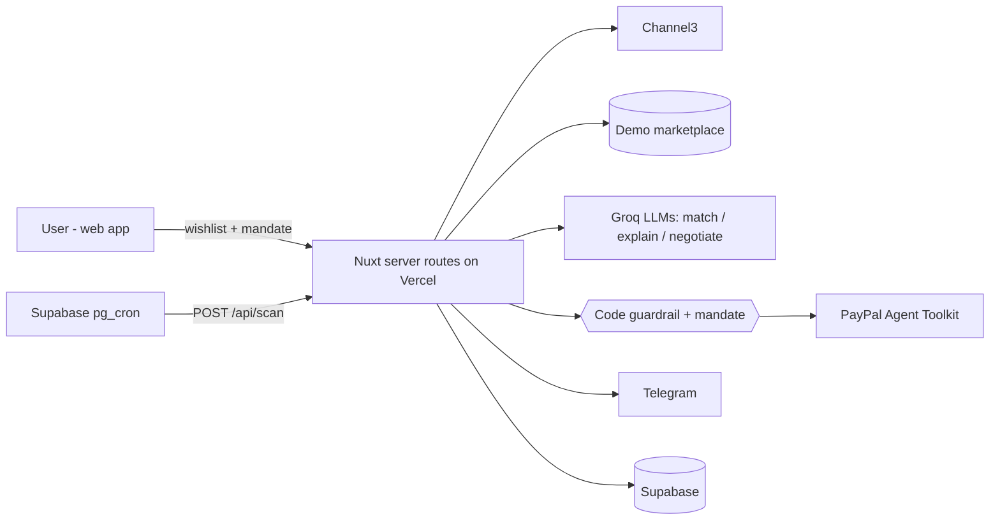

# DealHound 🐕 — your AI buyer's agent

> Tell it what you want and your maximum price. It watches for listings, screens out scams, haggles with the seller
> inside a spending limit that is enforced in code, pings you on Telegram, and you approve the payment with PayPal.

Built for the **PayPal AI Hackathon 2026**. Working name.

## The problem
- Good deals are scattered across retailers and secondhand listings; checking them by hand is a chore.
- Haggling is awkward, so most people overpay.
- Bargain hunters are exactly who "too good to be true" scam listings target.
- Letting an AI agent spend money is only acceptable if it provably cannot overspend or be talked into it.

## What it does
1. **Wishlist + mandate** — "Sonaro WH-700 headphones, max $300". The mandate (limit, expiry, approval required) is the only authority the agent has.
2. **Watch** — on a schedule and on demand, the agent searches **Channel3** (real retail offers) and a secondhand marketplace.
3. **Match** — an LLM rejects look-alikes (older model, accessory only, wrong variant).
4. **Scam check** — statistics against retail price comps plus rule signals, each with **quoted evidence** from the listing.
5. **Negotiate** — a buyer agent haggles with the seller's agent. Every move passes a code guardrail; prompt-injection attempts by sellers are detected, shown and ignored.
6. **Notify** — Telegram message with the deal, the risk verdict and an *Approve & pay* button.
7. **Pay** — the agent creates the PayPal order through the **PayPal Agent Toolkit**; the tool call is blocked unless the amount equals the agreed price and fits the mandate. You approve in PayPal; the payment is captured.

Retail offers found through Channel3 are bought at the retailer (the agent sends the link and uses their prices as comps);
PayPal checkout applies to marketplace listings.

## How PayPal is used
- **PayPal Agent Toolkit** (`@paypal/agent-toolkit`): `create_order` and `pay_order` (capture) are called as agent tools.
- **Mandate guard** (`server/lib/integrations/paypal-toolkit.ts`): every toolkit call runs through code that enforces *one item, exact agreed amount, USD, within the user's mandate* before PayPal is contacted — a tool call inflated by a manipulated model becomes a tool error, not an order. Covered by tests.
- **Orders v2 flow**: create → buyer approval → capture on return (sandbox).

## How AI is used
| Component | Model | Role |
|---|---|---|
| Matcher | Groq `openai/gpt-oss-120b` | One structured call per batch of listings: is this really the wanted item? |
| Risk explanation | Groq `openai/gpt-oss-20b` | Turns computed signals into a short explanation (signals and scores are computed in code) |
| Buyer agent | Groq `openai/gpt-oss-20b` | Structured offers under the guardrail |
| Seller agents | Groq `openai/gpt-oss-20b` | Demo marketplace counterparties with personas and hidden floor prices |
| Checkout agent | Groq `openai/gpt-oss-120b` | Calls the guarded PayPal toolkit tool |

All model access goes through the Vercel AI SDK (`ai` + `@ai-sdk/groq`) in one file (`server/lib/ai/model.ts`), so the provider is a setting: `AI_PROVIDER=groq` (default) or `google` (Gemini via `@ai-sdk/google`). Every model answer is schema-validated and has a deterministic fallback, so the app keeps working through rate limits.

## Tech stack
Nuxt 4 (Vue 3, TypeScript) · Nuxt UI · **AG Grid** (Deals board) · Supabase (Postgres, Auth, Realtime, pg_cron) ·
Vercel AI SDK + Groq (`gpt-oss`) · PayPal Agent Toolkit (sandbox) · **Channel3** product search · Telegram Bot API · Vercel · Vitest.


Details: [`docs/ARCHITECTURE.md`](docs/ARCHITECTURE.md).

## Run it locally
```bash
# Node 20+, pnpm 10
pnpm install
cp .env.example .env            # fill in the values (Supabase, Groq, PayPal sandbox, Channel3, Telegram)
# Supabase SQL editor: run supabase/migrations/0001_init.sql once
pnpm db:seed                    # demo marketplace + demo account
pnpm dev                        # http://localhost:3000  →  "Use the demo account"
pnpm test && pnpm typecheck
```

## Try the hosted demo
- URL: `TODO`
- App login: "Use the demo account" on the login page (`TODO email` / `TODO password`)
- PayPal sandbox buyer (to approve the payment): `TODO email` / `TODO password`
- Telegram (optional): Settings → "Link Telegram". Without it, deals appear in the app and the *Approve & pay* button is on the deal page.
- Settings → "Reset demo data" starts the scenario again.

The demo marketplace uses fictional brands and AI seller agents (including a scammer and a seller that attempts prompt
injection) so the whole flow can be shown safely. Channel3 results are real retail offers.

## Repository map
```
app/                        pages, components (C)
server/api/                 thin HTTP routes
server/lib/ai/              matcher, risk engine, guardrail, negotiation (A)
server/lib/integrations/    Channel3, scan, Telegram, checkout, guarded PayPal toolkit (B)
shared/types/               the data contract
supabase/                   schema, seed data, cron
docs/                       scope, architecture, stack notes, agent-team playbook, specs
```
Built by three people, each leading a Claude Code agent team — see [`docs/AGENT_TEAMS.md`](docs/AGENT_TEAMS.md).

## Roadmap
Real secondhand-marketplace integrations · PayPal Vault for automatic purchase inside a mandate · paying the seller's
own PayPal account · approvals through PayPal payment links in any chat · more currencies.

## License
MIT — see [`LICENSE`](LICENSE).
