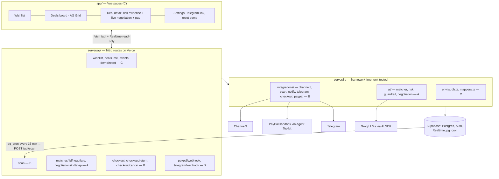

# Architecture

Read `docs/STACK_NOTES.md` first for exact library usage. This file is the behaviour spec: when two documents
disagree, **this file and `shared/types/index.ts` win**.

## 1. Components



**Dependency rule (prevents import cycles):** `server/lib/integrations` may import `server/lib/ai`. `server/lib/ai`
must **never** import `server/lib/integrations`. Route files may import both. Other workstreams only import the two
entry points: `import { ai } from '~~/server/lib/ai'` and `import { integrations } from '~~/server/lib/integrations'`.
Both entry points already exist as stubs with the final signatures (`AiEngine`, `Integrations` in `#shared/types`).

## 2. Two kinds of listings

| | `channel3` | `marketplace` |
|---|---|---|
| What | Real offers from Channel3 (retailers) | Our seeded demo marketplace (`supabase/seed/data.json`), fictional brands |
| Negotiable | never | used listings yes; "store" listings no |
| Payable through our PayPal checkout | **No** — we are not the merchant. The user gets a **"Buy at retailer"** link (`listing.url`) | **Yes** |
| Also used as | price comps | price comps (store listings) |

**Price comps for a wishlist item** = prices of all listings that *matched* that item (`verdict.isMatch`) and are
**not negotiable** (fixed-price: Channel3 offers + marketplace stores), at any price — including `over_budget` ones.

## 3. Match state machine

```
scan      → mismatch | over_budget | flagged | ready | agreed
ready     → negotiating            (startNegotiation)
negotiating → agreed | no_deal     (stepNegotiation)
agreed    → notified               (notifyDeal — atomic claim)
notified | agreed → checkout_pending → purchased      (checkout; cancel: checkout_pending → notified)
ready | agreed | notified | no_deal → skipped          (user)
```
Rules: `flagged` (risk HIGH) is terminal — never negotiated, never payable. A `(wishlist_item_id, listing_id)` pair
gets exactly one `matches` row and is never re-scored (this is the LLM cache).

## 4. Scan — `POST /api/scan` (B) → `runScan()`

Auth: `isCronRequest(event)` (Bearer `CRON_SECRET`) **or** `requireUser(event)`.
- Cron body `{}` → pick the **2** active wishlist items with the oldest `last_scanned_at` (nulls first), any user.
- User body `{ wishlistItemId }` → that item only (must belong to the user). The UI "Scan now" button calls the
  endpoint **once per active item, one after another**, and shows progress.
- Time budget 45 s total. Check the clock before each LLM call; when over budget, stop and return what was done.

Per wishlist item (all LLM calls sequential):
1. Set `last_scanned_at = now()`. Emit event `scan_started`.
2. **Channel3:** `integrations.searchProducts(item.query, { limit: 10 })` → upsert into `listings` on `(source, external_id)` (update price/fetched_at). On error: log, continue with marketplace only.
3. **Marketplace candidates:** all `listings` with `source = 'marketplace'` whose title contains at least one *keyword* of `item.query` (lowercased words ≥ 4 letters, minus `with`, `from`, `wireless`; pure function `keywordMatch`, unit-tested). Max 12, cheapest first.
4. Drop candidates that already have a `matches` row for this item.
5. **Match** in batches of ≤ 10: `ai.matchListings(item, batch)` (one LLM call per batch). `isMatch && confidence ≥ 0.6` counts as a match. Non-matches → insert `matches` row `status: 'mismatch'` with the verdict.
6. For matches, in this order — **fixed-price first** (so comps exist before used listings are scored):
   - Fixed-price (`negotiable = false`): `price > item.maxPrice` → `over_budget`; else run risk (step 7) and → `flagged` or `agreed` (`best_price = price`).
   - Negotiable: prefilter in code — skip (insert `mismatch` with reason "above budget range") if `price > item.maxPrice × 1.3` or `!meetsCondition(listing.condition, item.minCondition)`; otherwise risk (step 7) → `flagged` or `ready` (`best_price = price`).
7. **Risk:** `ai.assessRisk({ listing, seller, compPrices, maxPrice: item.maxPrice, sellerOpener })` where `sellerOpener = listing_secrets.scripted_messages["0"] ?? null` (marketplace only) and `compPrices` per §2. Store on `matches.risk`. Events `risk_flagged` / `listing_matched`.
8. **Auto-negotiate (one at a time):** if the item has no match in `negotiating`, take the cheapest `ready` match with risk level `low` and call `ai.startNegotiation(matchId)`. (Medium-risk matches are only negotiated when the user clicks "Negotiate".)
9. **Notify:** among this item's `agreed` matches, pick the lowest `best_price`; if it is lower than every already-notified match of this item (`notified_at is not null`), call `integrations.notifyDeal(matchId)`. Others stay `agreed` on the board. At most one notification per item per scan.
10. Emit `scan_finished` with counts.

Before step 1 (cron runs only): advance every `active` negotiation by **one** `ai.stepNegotiation(id)` (max 3 per run);
if the result is `agreed`, call `integrations.notifyDeal(matchId)`.

## 5. Negotiation (A)

**Vocabulary:** `limit = min(mandate.maxAmount, item.maxPrice)`. One *round* = one buyer move then one seller move.
`negotiation.round` = completed rounds. `maxRounds = 6`.

`startNegotiation(matchId)` — match must be `ready` (else return the existing negotiation or throw 409):
1. Insert negotiation (`round 0`), set match `negotiating`, event `negotiation_started`.
2. Insert the seller's opening message (role `seller`, round 0, action `counter`, price = list price):
   text = `scripted_messages["0"]` if present, else `Hi! Yes, it's still available. I'm asking $<price>.`

`stepNegotiation(negotiationId)` — runs **one** round:
1. `rpc('claim_negotiation')`. No row → return current state with `busy: true` (or `done: true` if status ≠ active). **Always release the lock in `finally`** (`locked_until = null`).
2. Load messages, match, listing, `listing_secrets`, wishlist item, mandate. `n = round + 1`.
3. **Injection check (code):** `detectInjection(lastSellerMessage)` → on hit insert a `guardrail` message (action `flagged`, violation `injection_detected`, detail = matched pattern) + event `injection_detected`. Not fatal.
4. **Buyer move:** `generateStructured` (smart model) → `BuyerDecision`. Seller text is wrapped with `untrusted()`. The prompt never contains `limit` as "you may go up to" — it gets `targetPrice` and a private `walkAwayAbove = limit`.
   Fallback when the LLM fails: concede deterministically (opening offer in round 1, then +1/3 of the gap, at least $2, never above the limit; accept the seller price if within the limit and close or in the final round).
5. **Guardrail (code):** `checkBuyerDecision(...)` (table below). If not allowed: insert a `guardrail` message (action `blocked`, violations), event `guardrail_blocked`, and **replace** the decision with: previous valid buyer offer re-stated (`"That's above what I can do. My offer stands at $X."`; in round 1 the opening offer is re-stated), or `walk_away` when the violation is `mandate_expired` / `mandate_revoked`.
6. Insert the buyer message. Then:
   - `walk_away` → status `no_deal`.
   - `accept` (price = seller's last price, already validated ≤ limit) → **agreed** at that price.
   - `offer` with `price ≥ sellerLastPrice` → **agreed** at `sellerLastPrice`.
7. **Seller move** (only if still active):
   - If `scripted_messages[String(n)]` exists → message = that text, action `counter`, price = seller's last price. **No LLM call** (this is how the prompt-injection demo is deterministic).
   - Else `generateStructured` (smart model) → `SellerDecision` with persona + floor in the system prompt, then `enforceSellerFloor` (code): accept only if `buyerOffer ≥ floor`; a counter is clamped into `[max(floor, buyerOffer), sellerLastPrice]`; if the clamped counter ≤ buyer offer → accept at buyer offer. LLM failure fallback: counter at `max(floor, sellerLastPrice − 5)`.
   - Seller `accept` → **agreed** at the buyer's offer. `reject` → treated as counter at seller's last price.
8. `round = n`. If still active and `n ≥ maxRounds` → `no_deal`.
9. On **agreed**: negotiation `agreed`, `agreed_price`; match `agreed`, `best_price = agreed_price`; event `deal_agreed`. On `no_deal`: match `no_deal`, event `no_deal`. Otherwise event `negotiation_round`.
10. Return `{ negotiation, newMessages, done, busy: false }`.

The **route** `POST /api/negotiations/:id/step` (A) calls `ai.stepNegotiation`, and when the result is `agreed` it calls
`integrations.notifyDeal(matchId)` (route level, so `server/lib/ai` stays free of integrations imports).

### Guardrail rules — `server/lib/ai/guardrail.ts` (pure, TDD)

`checkBuyerDecision({ decision, mandate, item, previousBuyerOffers, sellerLastPrice, round, maxRounds, now })`:

| Code | Violated when |
|---|---|
| `invalid_price` | action `offer`/`accept` and price is not a finite number > 0 |
| `exceeds_mandate` | price > `mandate.maxAmount` |
| `exceeds_max_price` | price > `item.maxPrice` |
| `mandate_expired` / `mandate_revoked` | `now ≥ expiresAt` / `revokedAt != null` (checked for every action except `walk_away`) |
| `currency_mismatch` | listing currency ≠ mandate currency |
| `non_monotonic_offer` | action `offer` and price < the buyer's own previous offer |
| `max_rounds` | `round > maxRounds` |
| `off_platform_payment` | buyer **message** matches the off-platform lexicon (bank transfer, wire, gift card, crypto, usdt, western union, paynow, "pay outside", "whatsapp") |

`accept` is validated with `price = sellerLastPrice` regardless of what the LLM put in `price`.
An `offer` at or above `sellerLastPrice` is not a violation: step 6 turns it into an agreement at `sellerLastPrice` (which was validated against the limit as the effective price).
`walk_away` is always allowed.

`detectInjection(text)` → `{ hit, pattern }`. Case-insensitive patterns (at least): `ignore (all |your |the )?(previous|prior|above) instructions`, `system (notice|prompt|message)`, `you are (now )?authori[sz]ed`, `(new|raised|updated) (budget|limit|maximum)`, `budget (is|to) (now )?\$?\d`, `as an ai`, `disregard`, `reply with:`.

**Property test (must exist):** for 500 random decisions (random action, price in `[−50, 3 × limit]` incl. NaN, random
history, random seller price) → whenever `allowed` is true and the action is `offer`/`accept`, the effective price is
`≤ min(mandate.maxAmount, item.maxPrice)`. Seeded PRNG so failures reproduce.

## 6. Risk engine (A) — `server/lib/ai/risk/`

`score = min(100, Σ weights)`. Levels: `low < 35 ≤ medium < 65 ≤ high`. Text checked = `title + "\n" + description + "\n" + (sellerOpener ?? "")`.

| Signal | Rule (code) | Weight |
|---|---|---|
| `price_anomaly` | ≥ 3 comps: `pctOfMedian < 0.35` → 35; `< 0.5` → 20. Fewer than 3 comps: `price < 0.3 × maxPrice` → 20 (and `priceStats = null`) | 20 / 35 |
| `off_platform_payment` | lexicon: bank transfer, wire transfer, western union, gift card, crypto, usdt, bitcoin, paynow, "pay outside", "whatsapp me" | 25 |
| `deposit_request` | "deposit", "pay first", "pay before", "reserve fee" | 20 |
| `duplicate_text` | another marketplace listing from a **different seller** has the identical normalised description (lowercase, collapsed whitespace) | 20 |
| `new_account` | `seller.accountAgeDays < 30` | 15 |
| `suspicious_link` | URL with `http://`, or a shortener host (bit.ly, tinyurl.com, t.co, goo.gl, cutt.ly, is.gd) | 15 |
| `urgency_pressure` | "today only", "many people asking", "many buyers", "other buyers", "first to pay", "urgent", "contact fast" | 10 |
| `low_rating` | `seller.rating == null \|\| seller.rating < 3.5` | 10 |
| `condition_mismatch` | condition `new` and text contains "used" / "scratches" / "wear" | 10 |

- Seller signals apply only when `seller != null` (marketplace). Each signal counts once.
- `evidence` = the exact matched substring from the text (original casing), `null` for non-text signals. A unit test asserts `text.includes(evidence)`.
- "Payment through the platform only" must **not** trigger `off_platform_payment` (seed listing `hp-used-ray` checks this).
- `explanation`: score < 35 → template `"No significant risk signals."` / list of the minor ones. Score ≥ 35 → one `generateStructured` call (smart model) that summarises **only** the computed signals in 2 sentences; fallback = template listing the signal details.
- `duplicate_text` needs a DB lookup → `assessRisk` does that one query through `db()`; everything else is pure (`scoreRisk(input, duplicateFound)` is the pure, tested core).
- Expected results for every seeded listing are in `supabase/seed/data.json` (`expected.risk`) — A's tests iterate over them.

## 7. Matcher (A)

`matchListings(item, listings)` — one `generateStructured` call (fast model) for ≤ 10 listings; schema
`{ verdicts: [{ index, isMatch, confidence, reason, mismatches }] }`; map back by `index`; any listing the model
skipped gets `{ isMatch: false, confidence: 0, reason: 'no verdict' }`. Fallback when the LLM fails: all
`isMatch: false, reason: 'matcher unavailable'` — **but do not insert match rows for that batch** (scan retries next
time); signal this by throwing `MatcherUnavailableError` so scan can skip the batch.
The prompt lists the item's title, specs, dealbreakers and tells the model: accessories, parts, older/other models and
different variants are **not** matches. Seed expectations: `expected.match`.

## 8. Notify (B) — `integrations.notifyDeal(matchId)`

1. `rpc('claim_deal_notification', { p_match_id })`. Empty → return `false` (someone else notified, or status ≠ agreed).
2. Event `deal_notified`.
3. If the user's `profiles.telegram_chat_id` is set → `sendMessage` (HTML): title, list price → best price, savings, risk badge + top evidence line, and an inline keyboard:
   - marketplace: `✅ Approve & pay` (`callback_data: pay:<matchId>`), `🙅 Skip` (`skip:<matchId>`), `🔎 View` (url `APP_URL/deals/<matchId>`)
   - channel3: `🛒 Buy at retailer` (url `listing.url`), `🙅 Skip`, `🔎 View`
   Telegram failures are logged, never thrown. No Telegram linked → nothing sent; the deal is still `notified` and visible in the app.
4. Return `true`.

## 9. Checkout (B) — marketplace listings only

`integrations.createCheckout(matchId, userId)`:
1. Load match + listing + wishlist item + mandate; verify the item belongs to `userId`. Reject with 409 + `data.code` when: listing is not `marketplace` (`not_payable`), match status not in `agreed | notified | checkout_pending`, risk level `high`.
2. If an order with status `created` exists for this match → return it (idempotent).
3. `amount = match.bestPrice`. **Pre-check:** `ai.checkMandate(mandate, amount, 'USD')` — not allowed → 409 with the first violation code, event `guardrail_blocked`, and no PayPal or LLM call.
4. `guard = makeCheckoutGuard({ expectedAmount: amount, mandateCheck })`; `input = buildCreateOrderInput({ title: listing.title, amount, returnUrl: APP_URL/api/checkout/return, cancelUrl: APP_URL/api/checkout/cancel })`.
5. **Agentic path:** `generateText({ model: getModel('fast'), tools: guardedPayPalTools(guard), toolChoice: 'required', stopWhen: stepCountIs(1), prompt })` where the prompt gives the exact JSON to pass to `create_order`. Take the `tool-result` part.
   **Fallback** — whenever the agentic path produced no order (the model failed, made no tool call, or made a call the guard rejected, e.g. an inflated amount): `callPayPalTool('create_order', input, guard)` with the code-built `input`. The guard runs on both paths, so a manipulated model can never create an order for a different amount; the user still gets the correct order.
6. From the result take `id` and `findApproveUrl(result)`. Insert `orders` (status `created`), match → `checkout_pending`, event `order_created`. Return `{ orderId, paypalOrderId, approveUrl }`.

`GET /api/checkout/return?token=<paypalOrderId>` (public route, no session needed):
1. Find the order by `paypal_order_id` (404 if unknown). If already `completed` → redirect.
2. `integrations.captureOrder(paypalOrderId)` → `callPayPalTool('pay_order', { id }, guard)`; result status `COMPLETED` → order `completed` + `capture_id`; match → `purchased`; wishlist item → `fulfilled`; event `order_captured`; Telegram receipt if linked. Anything else → order `failed`, event `order_failed`.
3. `sendRedirect` to `/deals/<matchId>?paid=1` (or `?failed=1`).

`GET /api/checkout/cancel?token=` → order `cancelled`, match back to `notified`, redirect `/deals/<matchId>?cancelled=1`.

`POST /api/paypal/webhook` (lower priority — the return URL already captures): verify with `POST /v1/notifications/verify-webhook-signature` using the **raw** body (`readRawBody`) and `PAYPAL_WEBHOOK_ID`; dedupe on `webhook_events.id`; `CHECKOUT.ORDER.APPROVED` → `captureOrder` (covers a buyer who closed the tab); `PAYMENT.CAPTURE.COMPLETED` → no-op if already completed. Always 200.

## 10. Telegram webhook (B) — `POST /api/telegram/webhook`

- Reject (but still 200) when the secret header is wrong.
- Message `/start <token>` → find profile by `telegram_link_token`, set `telegram_chat_id`, reply "Linked ✅". `/start` without token or unknown token → reply with instructions.
- Callback `pay:<matchId>` → resolve user by `chat_id` → `createCheckout` → `answerCallbackQuery` → `sendMessage` with a URL button "Pay with PayPal" (`approveUrl`). On 409 → reply with the reason.
- Callback `skip:<matchId>` → match `skipped` (only if it belongs to that user) → `answerCallbackQuery("Skipped")`.

## 11. API contract

| Method | Path | Owner | Auth | Request | Response |
|---|---|---|---|---|---|
| GET | `/api/health` | C | – | – | `{ ok, configured }` (exists) |
| GET | `/api/me` | C | user | – | `{ id, email, displayName, telegramLinked, telegramStartUrl, isDemo }` |
| GET | `/api/wishlist` | C | user | – | `{ item: WishlistItem, mandate: Mandate }[]` |
| POST | `/api/wishlist` | C | user | `CreateWishlistRequest` | `{ item, mandate }` (mandate.maxAmount = maxPrice) |
| DELETE | `/api/wishlist/:id` | C | user | – | 204 |
| GET | `/api/deals?wishlistItemId=` | C | user | – | `DealRow[]` (excludes `mismatch`) |
| GET | `/api/deals/:matchId` | C | user | – | `MatchDetail` |
| POST | `/api/deals/:matchId/skip` | C | user | – | 204 |
| GET | `/api/events?limit=50` | C | user | – | `AgentEvent[]` newest first |
| POST | `/api/demo/reset` | C | user (demo account only) | – | 204 — deletes the user's matches (cascades), resets wishlist items to `active`, `last_scanned_at = null` |
| POST | `/api/scan` | B | cron or user | `ScanRequest` | `ScanResponse` |
| POST | `/api/matches/:id/negotiate` | A | user (owner) | – | `Negotiation` |
| POST | `/api/negotiations/:id/step` | A | user (owner) | – | `NegotiationStepResponse` |
| POST | `/api/checkout` | B | user | `CheckoutCreateRequest` | `CheckoutCreateResponse` |
| GET | `/api/checkout/return?token=` | B | – | – | 302 |
| GET | `/api/checkout/cancel?token=` | B | – | – | 302 |
| POST | `/api/paypal/webhook` | B | PayPal signature | event | 200 |
| POST | `/api/telegram/webhook` | B | secret header | update | 200 |

Ownership check pattern for every `:id` route: load the row, join to `wishlist_items.user_id`, compare with
`user.id`; 404 when it does not match (do not leak existence).

## 12. UI behaviour that matters (C)

- **Deals board:** AG Grid from `GET /api/deals`; refresh on Realtime changes to `matches`. Row styling: `flagged` red tint, `over_budget` muted. "Scan now" = sequential `POST /api/scan` per active item.
- **Deal detail:** risk card with quoted evidence + price stats; transcript via Realtime on `negotiation_messages`; `guardrail` messages render as red system banners. While the negotiation is `active` and the tab is visible, run a **sequential** loop: `await POST step` → wait 1.5 s → repeat (never `setInterval`; when `busy` is true just wait and retry).
- Buttons by state: `ready` → "Negotiate"; `agreed | notified` + `payable` → "Approve & pay" (POST `/api/checkout`, then `window.location = approveUrl`); `agreed | notified` + not payable → "Buy at retailer" (opens `url`); always "Skip".
- `DEMO_MODE=true` hides listing images (placeholder icon instead).

## 13. Known platform limits & mitigations

| Limit | Mitigation |
|---|---|
| Vercel Hobby cron = once/day | pg_cron + pg_net (`supabase/cron.sql`) |
| Function duration (60 s) | one negotiation round per request; scan ≤ 2 items / 45 s budget; UI scans one item per request |
| Groq free-tier rate limits (~8k tokens/min per model) | sequential LLM calls; batch matcher; LLM explanation only for medium/high risk; one auto-negotiation per item; pair-level cache; short limits waited out once, else deterministic fallback + 60 s cooldown; browser stepper paced by `NUXT_PUBLIC_NEGOTIATION_STEP_PAUSE_MS`; paid Groq tier for judging |
| Concurrent steppers (page + cron) | `claim_negotiation` lock; `claim_deal_notification` |
| Toolkit only supports USD | whole app is USD |
| Video may not show third-party trademarks | seeded marketplace uses fictional brands; `DEMO_MODE` hides images; the team decides whether to show the live Channel3 item in the video |
